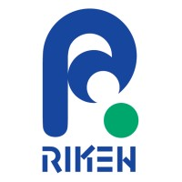
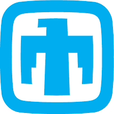
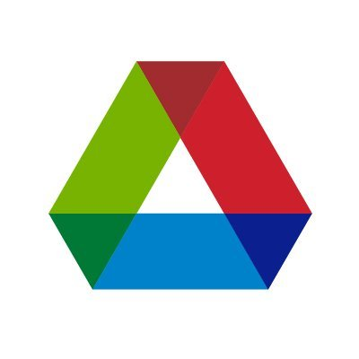
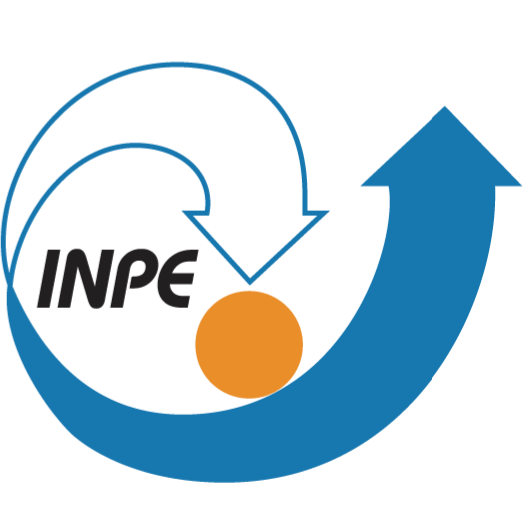
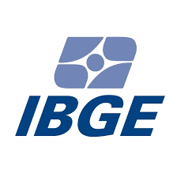

# Experience

  
  

    <strong>Internship</strong> — NVIDIA, Santa Clara, CA, USA <em>(May - Aug 2025)</em> 
    Technical Product Management for CUDA. Surveyed 39 developers from 25 teams in the CUDA software stack to understand their experiences and pain points with a new system. Defined distributed developers personas and identified key areas of focus for future product development. This project won the NVIDIA Intern Showcase Competition 2025.
  

  
  

    <strong>Internship</strong> — RIKEN Center for Computational Science, Kobe, Japan <em>(Jul - Sep 2024)</em> 
    Evaluated 3 years of hardware failures (3,262 total) on the Fugaku supercomputer (A64FX ARM-based) by device type, over time, and by physical location. Developed a toolset to predict failures in memory, interconnection and storage components using XGBoost, Random Forest and Decision Tree. Used generative AI for data augmentation resulting in similar accuracy than real data but reduced precision due to the noise in the synthetic samples.
  

---

  
  

    <strong>Research Assistant at NEU with Sandia National Laboratory <em>(2023 - present)</em> </strong>
    Evaluated Darshan-LDMS, a tool to collect telemetry and I/O access information in large-scale systems during runtime. Run I/O microbenchmarks (HACCIO, IOR, IOZone). Created Jupyter notebooks tutorials to support new users.
  

  
  

    <strong>Research Assistant at NEU with Argonne National Laboratory <em>(2022)</em> </strong>
    Evaluated the overhead and performance of Trusted Execution Environments (enclaves) for 9 distributed benchmarks exploring I/O, memory, CPU, and network for AMD SEV (EPYC 7601) and AWS Nitro instances with AMD and Intel processors.
  

  
  

    <strong>Student Researcher at UFSM with the National Institute for Space Research <em>(2018/19)</em> </strong>
    Parallelized a clustering algorithm with OpenACC, using 2xNVIDIA Tesla K80, achieving up to 48x speedup compared to the serial CPU-only. Developed a web portal for remote execution of the algorithms.
  

  
  

    <strong>Census Taker</strong> — Brazilian Institute of Geography and Statistics <em>(2014)</em> 
    Interviewed the population for the Continuous National Household Sample Survey.
  

----

# Volunteering

  

    
2025–2026

    

      <strong>Vice-President</strong> at <a href="http://brazilconference.org">Brazil Conference</a> 
      Led the AI4Good social impact program over 8 months, selecting and supporting 8 projects from Brazil through mentorship and workshops. Organized a Demo Day with a jury to select 3 winning teams, which were invited to present at a conference hosted at Harvard and MIT in March. Managed a team of 7. 
    

  

  

    
2019–Current

    

      <strong>Leader</strong> at <a href="http://braziliansintech.com">Brazilians in Tech</a> 
      An organization for Brazilian women in STEM. Responsible for the website development, marketing, communication, and community engagement.
    

  

  

    
2020–2022

    

      <strong>Chair</strong> for the <a href="https://permavost.github.io/2021.html">PERMAVOST Workshop</a> 
      In conjunction with ACM HPDC. Co-created the workshop with two colleagues from the Students@SC program.
    

  

  

    
2023

    

      <strong>Media Chair</strong> for IEEE eScience
      Responsible for creating artwork and media content about the conference.
    

  

  

    
2022

    

      <strong>Artifacts Evaluator</strong> for Supercomputing (SC) 
      Evaluated the code, data and experimental setup of accepted papers.
    

  

  

    
2020, 2021

    

      <strong>Student Lead Volunteer</strong> for Supercomputing (SC) 
      During my MSc in Brazil.
    

  

  

    
2018, 2019

    

      <strong>Student Volunteer</strong> for Supercomputing (SC) 
      During my BCs in Brazil.
    

  

  

    
2018–2019

    

      <strong>Instructor</strong> UniEscola 
      Presented STEM careers to female students at 5 schools in Santa Maria, Brazil. Guided activities using Code.org for 54 students.
    

  

  

    
2018–2019

    

      <strong>Mentor</strong> Brazilian Olympiad of Informatics 
      Mentored middle school students to prepare for the exam. Hosted the regional exam in the university.
    

  

  

    
2015–2018

    

      <strong>Instructor</strong> Computing Club 
      Introduced computational thinking to K-12 students in rural areas from Brazil. Organized free activities using Code.org, Blockly-Games, MIT App Inventor, and Studio Sketchpad.
    

  

  

    
2014

    

      <strong>Leader of Media</strong> at the FIFA World Cup in Porto Alegre, Brazil.
    

  

