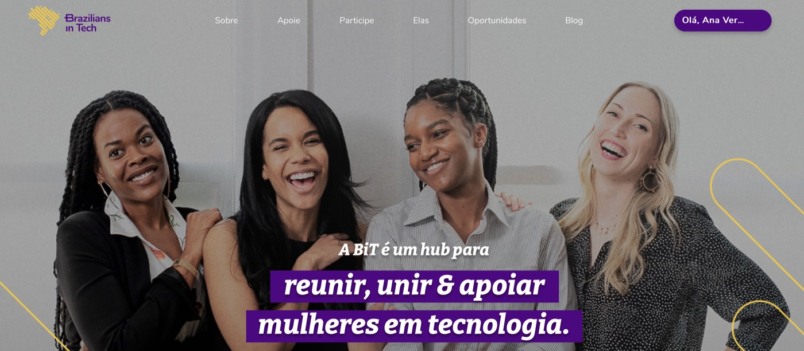
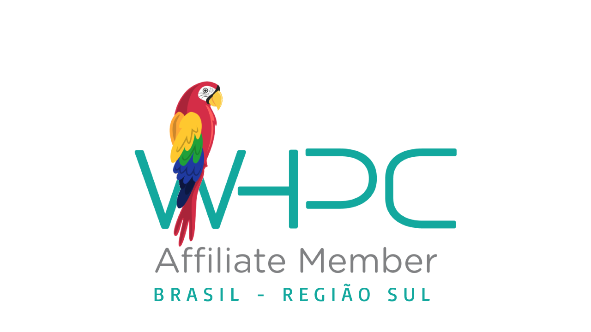
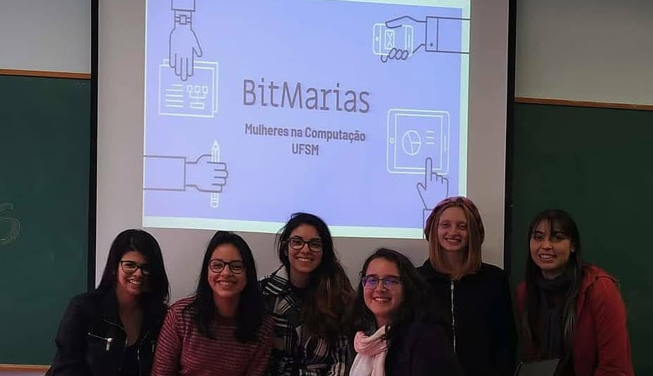

Projects I am passionated about:

## [Brazilians in Tech](http://braziliansintech.com) - Founder & Leader 

Organization created in 2019 to connect Brazilian women in distinct fields in technology and share opportunities. Our community has several women from all the 26 states in Brazil, with 47 volunteers since we started. In our group and newsletter, we share jobs, internships and scholarships. In our social media and blog we give visibility to Brazilian women and their accomplishments. We also oferred a free programming course in partnership with the Kenzie Academy that reached more than 4,400 women registered.

## [Women in HPC Affiliate, South of Brazil](https://medium.com/brazilians-in-tech/mulheres-em-computação-de-alto-desempenho-81cd045f9d5b) - Founder 

Affiliate organization of the [Women in HPC](http://whpctransfer.wpenginepowered.com/membership/chapters-and-affiliates/map). The first official group for women in the field in Latin America. We organized activities to introduce the field of HPC to undergraduate students in Computer Science, created expert panels with female professors from Brazil, and participated in national and regional events.

## [BitMarias](https://www.instagram.com/bitmarias/) - Founder

The first group of women in Computer Science and Systems at the Federal University of Santa Maria ([UFSM](https://www.ufsm.br/)), in Brazil. Officially recognized by the Department of Computer Science, BitMarias is a group to assist women and underrepresented students, to foster a sense of community, and to inspire girls to pursue careers in computing through participation in university fairs and outreach initiatives.

 

<!-- Being out of my comfort zone and having a purpose is what pushes me forward every day. At the end, it is the value of the fight that matters. -->